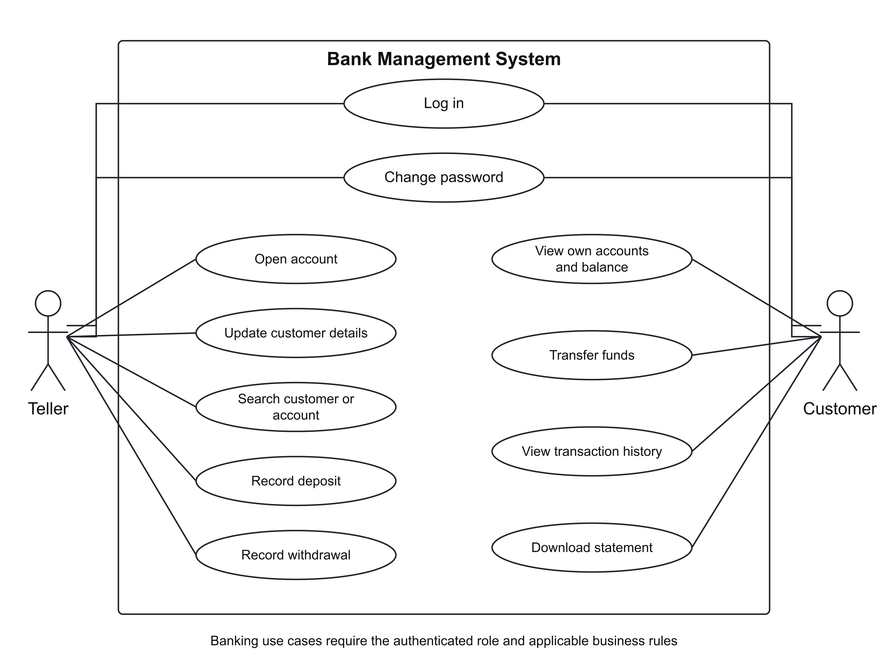
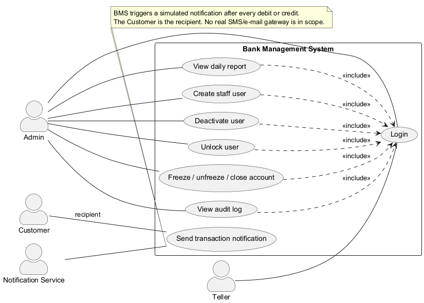

# Software Requirements Specification

Bank Management System

Version 1.0 | Consolidated revision | 15 November 2026 | Approval pending

| Document owner | Tarini Arora - SRS owner; Ronit Prasad - integration revision |
| --- | --- |
| Team | BMS_PES |
| Contributors to source sections | Member 2: Account Management; Member 3: Transactions; Member 4: Admin, NFRs, Security and RTM |
| Date | 15 November 2026 |
| Repository destination | docs/srs/SRS_BankManagementSystem_v1.0.docx |
| Document status | Consolidated requirements revision for team review. Approval pending. |

This document specifies intended requirements. It does not claim that the features have been implemented, deployed or tested.

## Document Control

| Version | Date | Owner / contributor | Change summary | Approval |
| --- | --- | --- | --- | --- |
| 1.0 - draft | 13 Oct 2026 | Member 1 - Tarini Arora | Integrated the supplied Section 4.2, 4.3 and 4.4 / Section 5 / security / RTM contributions; drafted Sections 1-3 and reconstructed Section 4.1 from the RTM summaries; recorded open issues. | Pending review |
| 1.0 consolidated | 15 Nov 2026 | Ronit Prasad | Reconciled business rules and references; documented integration dispositions; unified artifacts; added the Customer and Teller use-case diagram. | Pending team review |

## Contents

1. Introduction

1.1 Purpose

1.2 Scope

1.3 Document conventions and terminology

1.4 References

2. Overall Description

2.1 Product perspective

2.2 Product functions

2.3 User classes

2.4 Operating environment

2.5 Constraints

2.6 Assumptions and dependencies

3. External Interface Requirements

3.1 User interface

3.2 Software interface

3.3 Communication interface

4. System Features

4.1 Authentication and access control

4.2 Account management

4.3 Transactions

4.4 Admin, audit, reporting and notification

5. Non-functional and security requirements

5.1 Security objectives

5.2 Security requirements

6. Business Rules and Constraints

7. System Models and Diagrams

8. Requirements Traceability Matrix (RTM)

9. Integration review dispositions

## 1. Introduction

### 1.1 Purpose

This Software Requirements Specification (SRS) defines the functional, non-functional, security, interface and traceability requirements for the Bank Management System (BMS) software engineering mini-project. It provides a common baseline for design, implementation, testing and review. Requirements in this specification describe intended behaviour; they are not evidence that a feature has been implemented or verified.

### 1.2 Scope

The BMS is a web-based system for a single bank. It supports three user roles - Customer, Teller and Admin - and is intended to cover account opening and account information, cash deposits and withdrawals, internal BMS fund transfers, transaction history and downloadable statements, administrative Teller management, audit-log review, daily transaction reporting, and simulated debit/credit notifications.

The system excludes automated teller machine functionality and real external SMS/e-mail gateway delivery. Transfers are between accounts within this BMS; notifications are simulated records written to the notification log.

### 1.3 Document conventions and terminology

- "Shall" identifies a mandatory requirement. Each requirement has a fixed identifier; requirement IDs from the supplied contributions are preserved.

- BMS - Bank Management System; SRS - Software Requirements Specification; RTM - Requirements Traceability Matrix; NFR - non-functional requirement.

- Customer - user who can view their own accounts, transfer funds, and view/download transaction history and statements.

- Teller - bank staff user who opens accounts, updates customer contact details, searches customers, and records cash deposits/withdrawals.

- Admin - staff role that manages Teller user accounts, changes account status, reviews audit logs and generates daily reports.

- ACID - atomicity, consistency, isolation and durability. REST/JSON - the stated web API interface style.

- Acceptance criteria and test identifiers describe planned verification. The RTM retains the baseline planning status N; current implementation and test-execution verdicts belong in the Test Plan and its evidence, not in this specification.

### 1.4 References

- Repository README.md: SE_Jackfruit - Bank Management System (project scope, fixed technology baseline and repository structure).

- Requirement baseline v1.2 is the label referenced by the Account Management contribution; Version 1.0 identifies this SRS document. Business rules are consolidated in Section 6 using the existing PR requirements, section contributions and repository constants; these are separate version labels.

- SRS_part_M2_Account.docx - Member 2 contribution, Section 4.2 Account Management.

- SRS_part_M3_Transactions.docx - Member 3 transaction contribution, Section 4.3 Transactions.

- SRS_part_M4_Admin_NFR_Security_RTM.docx - Member 4 contribution, Section 4.4, Section 5, security objectives/requirements, use-case diagram description and RTM.

- SAD_BankManagementSystem_v1.0.docx / .pdf and docs/diagrams/* - architecture/design and diagram sources to be checked during cross-document review.

- Test_Plan_BankManagementSystem_v1.0.docx - planned test cases and verification methods; all cited test IDs must be cross-checked against this document.

## 2. Overall Description

### 2.1 Product perspective

The BMS is described as a layered web application. The fixed project technology baseline in the repository README is Python 3 with FastAPI for REST/JSON, SQLite accessed through SQLAlchemy, an HTML/CSS/JavaScript web interface, pytest for automated testing, and GitHub Actions for CI. This SRS does not introduce a different stack.

### 2.2 Product functions

- Authenticate users, establish sessions, lock accounts after repeated failed login attempts, enforce roles and support password change / first-login password change.

- Open Savings and Current accounts, maintain customer contact details, search customers, show a Customer their own account details and balance, and let Admins freeze, unfreeze or close accounts.

- Record deposits and withdrawals, transfer funds between eligible BMS accounts, show filtered transaction history and mini-statements, and provide CSV/PDF statement downloads.

- Allow Admins to create, deactivate and unlock Teller users, review filtered audit logs, and generate daily transaction summaries.

- Record simulated e-mail/SMS notification entries after debit or credit events, without a real external gateway.

- Apply performance, availability, integrity, usability, compatibility, audit-retention and security requirements stated in Sections 5 and 9.

### 2.3 User classes

| User class | Main responsibilities / permitted functions |
| --- | --- |
| Customer | View only their own account details and balance; transfer funds from their account to another eligible BMS account; view transaction history and download statements; receive a simulated notification record after debit/credit activity. |
| Teller | Open Savings/Current accounts; update customer phone, e-mail and address; search customers; record eligible deposits and withdrawals. |
| Admin | Create, deactivate and unlock Teller user accounts; freeze, unfreeze or close accounts subject to the balance rule; review filtered audit logs; generate daily transaction summaries. |

The system must enforce these permissions on the server, not only through UI controls. The full permission matrix must remain consistent across this SRS, the SAD and the test plan.

### 2.4 Operating environment

- Backend/API: Python 3 and FastAPI, with REST/JSON interfaces.

- Database: SQLite through SQLAlchemy.

- Client: HTML, CSS and JavaScript in a browser; the compatibility target is the latest two versions of Chrome, Edge and Firefox, including a 360 px viewport.

- Verification/automation: pytest and GitHub Actions per the repository baseline; load/performance and usability tools must be identified in the test plan where applicable.

### 2.5 Constraints

- The project is for one bank and the source baseline expressly excludes automated teller machine functionality.

- Notifications are simulated and stored in the notification log; real SMS/e-mail gateway integration is outside the supplied scope.

- Requirement IDs supplied by the section authors are fixed and must not be renumbered during integration.

- Business rules are consolidated in Section 6 and design references are reconciled in Section 8; changes to those baselines require team review.

### 2.6 Assumptions and dependencies

- Teller and Admin actions are performed by authenticated users assigned the appropriate role.

- The ledger/transaction records are the source used to reconcile displayed balances and daily summaries.

- A Customer may hold more than one account. Opening another account must not create a duplicate customer login (BR-08).

- The minimum balance, daily withdrawal limit, transaction limits, account-status rules, account identifiers and onboarding constraints are specified by BR-01 through BR-08 in Section 6.

- The Test Plan and SAD are maintained under docs/test-plan/ and docs/sad/. Section 8 maps the unchanged requirement IDs to test cases and design identifiers present in those documents.

## 3. External Interface Requirements

### 3.1 User interface

The system shall expose the supported functions through a simple browser-based HTML/CSS/JavaScript interface. The available functions shall depend on the authenticated role. The UI shall present clear rejection messages for invalid transactions and account-status restrictions, support the transaction-history and statement flows, and satisfy BMS-NF-006 browser and responsive-viewport targets.

### 3.2 Software interface

- The browser client communicates with the FastAPI backend through REST/JSON interfaces in accordance with the repository baseline.

- The backend accesses SQLite through SQLAlchemy. Database operations affecting a transfer must satisfy BMS-NF-003 atomicity.

- The system is intended to use pytest and GitHub Actions for automated verification/CI. Exact service/module contracts are controlled by the SAD.

### 3.3 Communication interface

Client-server communication shall use TLS 1.2 or higher under BMS-SR-001. Deployment and local certificate verification are described in the SAD and docs/security/us-27-verification.md. A local development setup is not evidence of production TLS or availability compliance.

## 4. System Features

### 4.1 Authentication and access control

Authentication requirements are reconciled with the Test Plan, BR-07, BR-08 and the existing authentication contracts. They specify required behavior; they do not assert that a pending password-change implementation has passed acceptance testing.

#### BMS-F-001 - Authenticate user and create session

| Requirement statement | The system shall authenticate a registered Customer, Teller or Admin using valid credentials and establish an authenticated session for the user. |
| --- | --- |
| Type / category | Functional |
| Priority | High |
| Source / stakeholder | Customer, Teller, Admin |
| Acceptance criteria / test reference | Valid credentials establish a session for the correct user; invalid credentials do not establish a session; protected functions reject requests without a valid session. Test: TC-Auth-01. |
| Dependencies / comments | DS-AUTH. Reconciled with TC-Auth-01 and DS-AUTH; acceptance remains subject to test execution. |

#### BMS-F-002 - Lock user after three failed logins

| Requirement statement | The system shall lock a user account after three consecutive failed login attempts. |
| --- | --- |
| Type / category | Functional |
| Priority | High |
| Source / stakeholder | Customer, Teller, Admin |
| Acceptance criteria / test reference | The third consecutive failed attempt puts the account into a locked state; a subsequent login is denied while the account remains locked. Test: TC-Auth-02. |
| Dependencies / comments | DS-AUTH. BR-07 requires an Admin to unlock a locked account. No automatic time-based unlock is specified. The same authentication lock state applies to all user roles. |

#### BMS-F-003 - Enforce role-based access

| Requirement statement | The system shall enforce role-based access to system functions for Customer, Teller and Admin users on the server. |
| --- | --- |
| Type / category | Functional |
| Priority | High |
| Source / stakeholder | Customer, Teller, Admin |
| Acceptance criteria / test reference | A request by a role that is not permitted to perform the action is denied by the server; UI hiding alone is not sufficient. Test: TC-RBAC-01. |
| Dependencies / comments | DS-AUTH; related security requirement BMS-SR-004. |

#### BMS-F-004 - Change password and force first-login change

| Requirement statement | The system shall allow an authenticated user to change their password and shall require a Customer issued a temporary password to change it at first login before using other protected banking functions. |
| --- | --- |
| Type / category | Functional |
| Priority | High |
| Source / stakeholder | Customer, Teller, Admin |
| Acceptance criteria / test reference | A user can complete the password-change flow; a Customer with a temporary password cannot access other protected functions until the first-login password change is completed. Test: TC-Auth-03. |
| Dependencies / comments | DS-AUTH; BMS-F-010 creates the temporary Customer credential. Password policy: at least 8 characters with an uppercase letter, a lowercase letter and a digit. The current password must be verified. Shared temporary-password restrictions also apply when a Teller is provisioned with a temporary credential under BMS-F-030. |

### 4.2 Account management

This feature group enables authorized Tellers to open accounts, update customer contact details and search customers; Admins can freeze, unfreeze or close accounts; Customers can view only their own account details and current balance.

#### BMS-F-010 - Open account and create first Customer login

| Requirement statement | The system shall allow a Teller to open a Savings or Current account by capturing name, date of birth, address, phone, e-mail and ID-proof number and an opening deposit that meets the minimum balance (BR-01), and shall create a Customer login with a system-generated temporary password for a customer who has none. |
| --- | --- |
| Type / category | Functional |
| Priority | High |
| Source / stakeholder | Bank Operations |
| Acceptance criteria / test reference | A unique 10-digit account number is generated; account status is Active; the opening deposit is recorded as a transaction; a Customer login is created with username equal to customer ID and a temporary password shown once to the Teller; no new login is created for an existing customer. Test: TC-Acc-01. |
| Dependencies / comments | BR-01, BR-06, BR-08; DS-ACC, DS-AUTH, DS-TXN, DS-DB. Temporary password must be changed at first login under BMS-F-004. E-mail is captured at onboarding for consistency with the customer record and BMS-F-011. This clarifies the field list without changing the requirement ID. |

#### BMS-F-011 - Update customer contact details

| Requirement statement | The system shall allow a Teller to update a customer's phone, e-mail and address and record the old and new values. |
| --- | --- |
| Type / category | Functional |
| Priority | Medium |
| Source / stakeholder | Bank Operations |
| Acceptance criteria / test reference | Updated values are visible immediately; an audit entry holds the old and new values. Test: TC-Acc-02. |
| Dependencies / comments | Audit recording; DS-ACC and DS-AUD. |

#### BMS-F-012 - Freeze, unfreeze or close account

| Requirement statement | The system shall allow an Admin to freeze, unfreeze or close an account; closure is permitted only when the balance is Rs 0. |
| --- | --- |
| Type / category | Functional |
| Priority | High |
| Source / stakeholder | Bank Operations / Compliance |
| Acceptance criteria / test reference | Frozen or closed accounts reject all transactions with a clear message; closure is rejected when the balance is not Rs 0. Test: TC-Acc-03. |
| Dependencies / comments | BR-04; DS-ACC and DS-TXN. Authorization must be enforced server-side. |

#### BMS-F-013 - Customer views own accounts and balance

| Requirement statement | The system shall allow a Customer to view details and current balance of only their own accounts. |
| --- | --- |
| Type / category | Functional |
| Priority | High |
| Source / stakeholder | Customer |
| Acceptance criteria / test reference | Displayed balance equals the ledger sum; attempting to access another customer's account returns HTTP 403. Test: TC-Acc-04. |
| Dependencies / comments | Server-side authorization under BMS-F-003 / BMS-SR-004; DS-ACC, DS-AUTH and DS-DB. |

#### BMS-F-014 - Search customers

| Requirement statement | The system shall allow a Teller to search customers by name, account number or phone and return results within 2 seconds. |
| --- | --- |
| Type / category | Functional |
| Priority | Medium |
| Source / stakeholder | Bank Operations |
| Acceptance criteria / test reference | Partial-name search works; searches by account number and phone return matching customers; no match shows "No results"; response is within 2 seconds. Test: TC-Acc-05. |
| Dependencies / comments | DS-ACC and DS-DB; displayed account numbers must follow BMS-SR-007 masking rules where applicable. |

### 4.3 Transactions (deposit, withdrawal, transfer, history and statements)

The system shall record cash deposits and withdrawals, transfer funds between eligible BMS accounts, and provide transaction history and downloadable statements. All money movement is subject to the referenced business rules; see Section 6 for the consolidated business rules.

#### BMS-F-020 - Record cash deposit

| Requirement statement | The system shall allow a Teller to record a cash deposit greater than Rs 0 and less than or equal to Rs 2,00,000 to an Active account and generate a receipt number. |
| --- | --- |
| Type / category | Functional |
| Priority | High |
| Source / stakeholder | Bank Operations / Customer |
| Acceptance criteria / test reference | The balance increases by the exact deposited amount and a transaction record is created. Test: TC-Dep-01. |
| Dependencies / comments | BMS-F-010; business rules BR-03 and BR-04. |

#### BMS-F-021 - Record withdrawal within balance and daily limit

| Requirement statement | The system shall allow a Teller to record a withdrawal only if the post-withdrawal balance is greater than or equal to the minimum balance and the daily limit (BR-02) is not exceeded. |
| --- | --- |
| Type / category | Functional |
| Priority | High |
| Source / stakeholder | Bank Operations / Customer |
| Acceptance criteria / test reference | A valid withdrawal reduces the balance; an invalid withdrawal is rejected with a reason. Tests: TC-WD-01 and TC-WD-02. |
| Dependencies / comments | Business rules BR-01, BR-02 and BR-05. |

#### BMS-F-022 - Transfer funds between BMS accounts

| Requirement statement | The system shall allow a Customer to transfer up to Rs 1,00,000 per transfer from their account to another Active BMS account, rejecting transfers with insufficient funds or frozen/closed accounts. |
| --- | --- |
| Type / category | Functional |
| Priority | High |
| Source / stakeholder | Customer / Business |
| Acceptance criteria / test reference | The debit and credit both succeed or both fail; two transaction records are created. Tests: TC-TR-01 and TC-TR-02. |
| Dependencies / comments | Business rules BR-03, BR-04 and BR-05; related to BMS-NF-003. |

#### BMS-F-023 - View transaction history and mini-statement

| Requirement statement | The system shall allow a Customer to view their account transaction history filtered by date range, with the latest 10 transactions shown as a mini-statement. |
| --- | --- |
| Type / category | Functional |
| Priority | Medium |
| Source / stakeholder | Customer |
| Acceptance criteria / test reference | Only transactions within the selected range are shown, newest first. Test: TC-Stmt-01. |
| Dependencies / comments | Depends on BMS-F-020, BMS-F-021 and BMS-F-022. |

#### BMS-F-024 - Download account statement

| Requirement statement | The system shall allow a Customer to download a statement in CSV or PDF format for a chosen date range. |
| --- | --- |
| Type / category | Functional |
| Priority | Low |
| Source / stakeholder | Customer / Compliance |
| Acceptance criteria / test reference | Totals in the downloaded file match the on-screen history. Test: TC-Stmt-02. |
| Dependencies / comments | Depends on BMS-F-023. |

### 4.4 Admin, audit, reporting and notification

This feature group provides authorized administration of Teller accounts, account-status changes, audit-log review, daily transaction reporting and simulated notification logging. Staff-management and account-status operations are restricted to Admin users. Notifications are written to a local log and are not sent through a real external SMS/e-mail gateway.

#### BMS-F-030 - Manage Teller user accounts

| Requirement statement | The system shall allow an Admin to create, deactivate and unlock Teller user accounts. |
| --- | --- |
| Type / category | Functional |
| Priority | High |
| Source / stakeholder | Bank Operations |
| Acceptance criteria / test reference | A new Teller can log in; a deactivated Teller cannot log in; an unlocked Teller can log in again. Test: TC-Adm-01. |
| Dependencies / comments | DS-ADM and Auth Service integration. |

#### BMS-F-031 - View filtered audit log

| Requirement statement | The system shall allow an Admin to view the audit log filtered by user, action type and date. |
| --- | --- |
| Type / category | Functional |
| Priority | Medium |
| Source / stakeholder | Bank Operations / Compliance |
| Acceptance criteria / test reference | The filter returns only matching entries. Test: TC-Aud-01. |
| Dependencies / comments | Audit entries are produced under BMS-SR-006. |

#### BMS-F-032 - Generate daily transaction summary

| Requirement statement | The system shall generate a daily transaction summary for Admin showing the count and total of deposits, withdrawals and transfers. |
| --- | --- |
| Type / category | Functional |
| Priority | Medium |
| Source / stakeholder | Bank Operations |
| Acceptance criteria / test reference | Report totals match the transaction table for the selected day. Test: TC-Rep-01. |
| Dependencies / comments | Uses transaction records for the selected day. |

#### BMS-F-033 - Log simulated transaction notification

| Requirement statement | The system shall create a simulated e-mail/SMS notification record for the Customer after every debit or credit. |
| --- | --- |
| Type / category | Functional |
| Priority | Low |
| Source / stakeholder | Customer / Bank Operations |
| Acceptance criteria / test reference | One notification record is created per credited or debited account. Test: TC-Not-01. |
| Dependencies / comments | No real SMS/e-mail gateway is in scope; the Customer is the recipient. |

## 5. Non-functional and security requirements

The quality requirements below are targets to be verified. Their inclusion is not a claim that the targets have already been achieved.

#### BMS-NF-001 - Transaction response time

| Requirement statement | At least 95% of deposit, withdrawal and transfer requests shall complete within 3 seconds with 50 concurrent users. |
| --- | --- |
| Type / category | Performance |
| Priority | High |
| Source / stakeholder | Bank Operations / Customer |
| Acceptance criteria / test reference | A load-test run with 50 concurrent users demonstrates a 95th-percentile response time no greater than 3 seconds. Test: TC-Perf-01. |
| Dependencies / comments | DS-TXN; load-test tool/configuration to be specified in the Test Plan. |

#### BMS-NF-002 - Availability and health endpoint

| Requirement statement | The system shall be available 99.5% of each month, excluding scheduled maintenance, and expose a /health endpoint. |
| --- | --- |
| Type / category | Reliability |
| Priority | Medium |
| Source / stakeholder | Bank Operations |
| Acceptance criteria / test reference | /health returns HTTP 200 within 1 second; availability is verified from an uptime log. Test: TC-Ops-01. |
| Dependencies / comments | DS-UI / platform; measure each calendar month excluding scheduled maintenance. Report the actual observation window; a smoke check does not demonstrate the monthly target. |

#### BMS-NF-003 - Atomic financial transactions

| Requirement statement | Every financial transaction shall be atomic (ACID): a failed transfer leaves both account balances unchanged. |
| --- | --- |
| Type / category | Data integrity |
| Priority | High |
| Source / stakeholder | Customer / Bank Operations |
| Acceptance criteria / test reference | A fault-injection test shows no partial transfer update: either both sides commit or neither does. Test: TC-TR-02. |
| Dependencies / comments | DS-TXN, DS-DB. Review note: Storage-side trace: DS-DB. |

#### BMS-NF-004 - First-time-user transfer usability

| Requirement statement | At least 90% of first-time users shall complete a fund transfer within 2 minutes without help. |
| --- | --- |
| Type / category | Usability |
| Priority | Medium |
| Source / stakeholder | Customer |
| Acceptance criteria / test reference | Test with n >= 5 first-time users. At least ceil(0.90 * n) must complete an accurate transfer within 120 seconds without assistance; for n = 5, all five must pass. Test: TC-UX-01. |
| Dependencies / comments | DS-UI; use the acceptance formula above and record genuine participant observations in TC-UX-01. |

#### BMS-NF-005 - Audit log integrity and retention

| Requirement statement | Audit logs shall be timestamped, append-only and retained for at least 5 years. |
| --- | --- |
| Type / category | Audit / retention |
| Priority | Medium |
| Source / stakeholder | Bank Operations / Compliance |
| Acceptance criteria / test reference | There is no ordinary application update/delete path for audit logs; retention configuration is verified. Test: TC-Aud-02. |
| Dependencies / comments | DS-AUD. |

#### BMS-NF-006 - Browser compatibility and responsive UI

| Requirement statement | The UI shall work on the latest two versions of Chrome, Edge and Firefox and be usable at a viewport width of 360 px. |
| --- | --- |
| Type / category | Compatibility |
| Priority | Medium |
| Source / stakeholder | Customer / Teller / Admin |
| Acceptance criteria / test reference | Manual checks pass on the specified browser versions and a 360 px responsive viewport. Test: TC-UX-02. |
| Dependencies / comments | DS-UI. The exact browser versions should be recorded when tests are performed. |

### 5.1 Security objectives

| Objective ID | Objective | Description |
| --- | --- | --- |
| BMS-SO-1 | Confidentiality | Customer and credential data shall be visible only to authorized users. Sensitive identifiers and authentication secrets shall be protected against unauthorized disclosure. |
| BMS-SO-2 | Integrity | Money movements and account data shall not be altered illegitimately or left in an inconsistent state. Validation, role enforcement and atomic transaction handling shall support this objective. |
| BMS-SO-3 | Accountability | Every security-relevant action shall be traceable to a user through timestamped audit records that identify the action and outcome. |

### 5.2 Security requirements

#### BMS-SR-001 - Require TLS for client-server communication

| Requirement statement | The system shall use TLS 1.2 or higher for all client-server communication. |
| --- | --- |
| Type / category | Security |
| Priority | High |
| Source / stakeholder | Customer / Teller / Admin |
| Acceptance criteria / test reference | Verification confirms that TLS 1.2 or higher is required for client-server communication. Test: TC-Sec-01. |
| Security objective link | BMS-SO-1 |
| Dependencies / comments | DS-SEC. |

#### BMS-SR-002 - Protect stored passwords

| Requirement statement | The system shall store passwords, including temporary passwords, only as salted bcrypt or Argon2 hashes and shall never write them to logs. |
| --- | --- |
| Type / category | Security |
| Priority | High |
| Source / stakeholder | Customer / Teller / Admin |
| Acceptance criteria / test reference | Stored password values are salted bcrypt/Argon2 hashes and password values are absent from logs. Test: TC-Sec-02. |
| Security objective link | BMS-SO-1 |
| Dependencies / comments | DS-AUTH. A temporary password shown once to a Teller must not be written to logs or retained in recoverable form. |

#### BMS-SR-003 - Expire idle sessions

| Requirement statement | The system shall expire a session after 10 minutes of inactivity. |
| --- | --- |
| Type / category | Security |
| Priority | Medium |
| Source / stakeholder | Customer / Teller / Admin |
| Acceptance criteria / test reference | A request after 10 minutes of inactivity is rejected and requires authentication. Test: TC-Sec-03. |
| Security objective link | BMS-SO-1 |
| Dependencies / comments | DS-AUTH. |

#### BMS-SR-004 - Enforce server-side authorization

| Requirement statement | The system shall enforce authorization by role on the server for every request. |
| --- | --- |
| Type / category | Security |
| Priority | High |
| Source / stakeholder | Customer / Teller / Admin |
| Acceptance criteria / test reference | A request by a role that is not eligible to perform the requested action is denied by the server. Test: TC-RBAC-01. |
| Security objective link | BMS-SO-1, BMS-SO-2 |
| Dependencies / comments | DS-AUTH. |

#### BMS-SR-005 - Validate input and mitigate SQL injection and XSS

| Requirement statement | The system shall validate input on the server, use parameterized database queries to mitigate SQL injection, and apply context-appropriate output encoding to prevent cross-site scripting (XSS). |
| --- | --- |
| Type / category | Security |
| Priority | High |
| Source / stakeholder | Customer / Teller / Admin |
| Acceptance criteria / test reference | SQL-injection inputs are safely handled by parameterized queries; XSS payloads are rendered inert or rejected by appropriate output encoding and validation. Test: TC-Sec-04. |
| Security objective link | BMS-SO-2 |
| Dependencies / comments | DS-SEC. Parameterized queries address SQL injection; context-appropriate output encoding addresses XSS. The security requirement ID is unchanged. |

#### BMS-SR-006 - Audit security-relevant actions

| Requirement statement | The system shall record every login, financial and admin action in the audit log with user, timestamp, action and outcome. |
| --- | --- |
| Type / category | Security |
| Priority | High |
| Source / stakeholder | Bank Operations / Compliance |
| Acceptance criteria / test reference | Required action records contain user, timestamp, action and outcome. Test: TC-Aud-01. |
| Security objective link | BMS-SO-3 |
| Dependencies / comments | DS-AUD. |

#### BMS-SR-007 - Mask account numbers and protect ID-proof numbers

| Requirement statement | The system shall mask account numbers by showing only the last four digits in lists and logs, and encrypt ID-proof numbers at rest. |
| --- | --- |
| Type / category | Security |
| Priority | Medium |
| Source / stakeholder | Customer / Bank Operations / Compliance |
| Acceptance criteria / test reference | Lists and logs show only the last four account-number digits; ID-proof numbers are encrypted at rest. Test: TC-Sec-05. |
| Security objective link | BMS-SO-1 |
| Dependencies / comments | DS-SEC. The storage/encryption approach should be agreed with the SAD owner. |

## 6. Business Rules and Constraints

The following rules consolidate the numeric and behavioral constraints already present in the PR requirements, section contributions and repository constants. Their identifiers and limits are retained; this revision does not introduce new transaction limits.

| Rule ID | Business rule | Traceability |
| --- | --- | --- |
| BR-01 | Savings minimum balance: Rs 1,000; Current minimum balance: Rs 5,000. Opening deposits must meet the applicable minimum. | BMS-F-010, BMS-F-021, BMS-F-022; MIN_BALANCE. |
| BR-02 | Withdrawals must not exceed Rs 50,000 per account per day. | BMS-F-021; DAILY_WITHDRAWAL_LIMIT; TC-WD-02. |
| BR-03 | Maximum cash deposit: Rs 2,00,000 per operation. Maximum transfer: Rs 1,00,000 per operation. | BMS-F-020, BMS-F-022; DEPOSIT_LIMIT, TRANSFER_LIMIT. |
| BR-04 | Frozen and closed accounts reject transactions. An account may be closed only when its balance is exactly zero. | BMS-F-012, BMS-F-020 through BMS-F-022. |
| BR-05 | Accounts must not be overdrawn. Debits must also preserve the applicable minimum balance. | BMS-F-021, BMS-F-022; account and transaction contributions. |
| BR-06 | Every account number is unique and contains exactly 10 digits. | BMS-F-010; account-number uniqueness constraint. |
| BR-07 | Three consecutive failed login attempts lock a user account. Only an authenticated Admin may unlock it; no automatic unlock interval is specified. | BMS-F-002, BMS-F-030; MAX_FAILED_LOGINS. |
| BR-08 | Customers do not self-register. The first account provisions a login only when one does not already exist. Username equals customer ID. A temporary password is returned once to the Teller, never logged or stored recoverably, and must be replaced before protected banking use. | BMS-F-004, BMS-F-010, BMS-SR-002; subsequent accounts reuse the customer login. |

Amounts must be positive and obey BR-01 through BR-05. BMS-SR-003 separately requires a 10-minute idle-session timeout.

## 7. System Models and Diagrams

### 7.1 Customer and Teller use cases

This view covers BMS-F-001 through BMS-F-004, BMS-F-010 through BMS-F-014 and BMS-F-020 through BMS-F-024. It separates Teller cash/onboarding functions from Customer-owned account, transfer, history and statement functions. The editable source is docs/diagrams/usecase-1-customer-teller.puml; its SVG and PNG are stored beside it.

Figure 1. Customer and Teller use-case diagram.

### 7.2 Admin and system use cases

This view is a readable rendering of the canonical docs/diagrams/usecase-2-admin.puml model. The original model and PNG are preserved; the SRS presentation uses usecase-2-admin-srs.puml, SVG and PNG with the same actors, use cases and associations. It covers staff management, account status, audit review, daily reports and simulated notifications.

Figure 2. Admin and system use-case diagram. Notifications are logged locally; no external SMS/e-mail gateway is in scope.

## 8. Requirements Traceability Matrix (RTM)

The RTM maps all 31 requirements: 18 functional, 6 non-functional and 7 security requirements. All 30 referenced test-case IDs exist in the integrated Test Plan, and the eight DS identifiers exist in the SAD. Planning status N is retained from the baseline; it is not a claim that implementation has not begun or that a test has passed.

| Req ID | Requirement summary | Section / design ref | Module | Test case(s) | Status | Comments |
| --- | --- | --- | --- | --- | --- | --- |
| BMS-F-001 | Authenticate user / create session | 4.1 / DS-AUTH | Auth Service | TC-Auth-01 | N | Reconciled with the authentication test plan and BR-07/BR-08. |
| BMS-F-002 | Lock user after 3 failed logins | 4.1 / DS-AUTH | Auth Service | TC-Auth-02 | N | Admin-controlled unlock; no automatic unlock period is specified. |
| BMS-F-003 | Enforce role-based access | 4.1 / DS-AUTH | Auth Service | TC-RBAC-01 | N |  |
| BMS-F-004 | Change password / force first-login change | 4.1 / DS-AUTH | Auth Service | TC-Auth-03 | N | Reconciled with the authentication test plan and BR-07/BR-08. |
| BMS-F-010 | Open account and create first Customer login | 4.2 / DS-ACC | Account Service | TC-Acc-01 | N |  |
| BMS-F-011 | Update customer contact details | 4.2 / DS-ACC | Account Service | TC-Acc-02 | N |  |
| BMS-F-012 | Freeze, unfreeze or close account | 4.2 / DS-ACC | Account Service | TC-Acc-03 | N |  |
| BMS-F-013 | Customer views own account and balance | 4.2 / DS-ACC | Account Service | TC-Acc-04 | N |  |
| BMS-F-014 | Teller searches customers | 4.2 / DS-ACC | Account Service | TC-Acc-05 | N |  |
| BMS-F-020 | Record cash deposit | 4.3 / DS-TXN | Transaction Service | TC-Dep-01 | N |  |
| BMS-F-021 | Record withdrawal within limits | 4.3 / DS-TXN | Transaction Service | TC-WD-01, TC-WD-02 | N |  |
| BMS-F-022 | Transfer funds between BMS accounts | 4.3 / DS-TXN | Transaction Service | TC-TR-01, TC-TR-02 | N |  |
| BMS-F-023 | View transaction history / mini-statement | 4.3 / DS-TXN | Transaction Service | TC-Stmt-01 | N |  |
| BMS-F-024 | Download CSV/PDF statement | 4.3 / DS-TXN | Transaction Service | TC-Stmt-02 | N |  |
| BMS-F-030 | Create, deactivate and unlock Teller users | 4.4 / DS-ADM | Admin & Reporting Service | TC-Adm-01 | N |  |
| BMS-F-031 | Admin filters and views audit log | 4.4 / DS-AUD | Audit & Notification Service | TC-Aud-01 | N |  |
| BMS-F-032 | Generate daily transaction summary | 4.4 / DS-ADM | Admin & Reporting Service | TC-Rep-01 | N |  |
| BMS-F-033 | Log simulated notification after every debit/credit | 4.4 / DS-AUD | Audit & Notification Service | TC-Not-01 | N |  |
| BMS-NF-001 | Transaction response time under 50-user load | 5 / DS-TXN | Transaction Service | TC-Perf-01 | N |  |
| BMS-NF-002 | 99.5% monthly availability and health endpoint | 5 / DS-UI | Web UI / Platform | TC-Ops-01 | N |  |
| BMS-NF-003 | Atomic financial transactions | 5 / DS-TXN, DS-DB | Transaction Service + Data Access Layer + Database | TC-TR-02 | N | Storage-side trace: DS-DB. |
| BMS-NF-004 | First-time-user transfer usability | 5 / DS-UI | Web UI / Platform | TC-UX-01 | N | At least ceil(0.90 * n) unaided successes within 120 s, n >= 5. |
| BMS-NF-005 | Timestamped, append-only, 5-year audit retention | 5 / DS-AUD | Audit & Notification Service | TC-Aud-02 | N |  |
| BMS-NF-006 | Browser compatibility and 360 px responsive UI | 5 / DS-UI | Web UI / Platform | TC-UX-02 | N |  |
| BMS-SR-001 | TLS 1.2+ for client-server communication | 5.2 / DS-SEC | Security Layer | TC-Sec-01 | N |  |
| BMS-SR-002 | Salted password hashes; never log passwords | 5.2 / DS-AUTH | Auth Service | TC-Sec-02 | N |  |
| BMS-SR-003 | Expire session after 10 minutes idle | 5.2 / DS-AUTH | Auth Service | TC-Sec-03 | N |  |
| BMS-SR-004 | Server-side role authorization every request | 5.2 / DS-AUTH | Auth Service | TC-RBAC-01 | N |  |
| BMS-SR-005 | Validate input; protect against SQL injection and XSS | 5.2 / DS-SEC | Security Layer | TC-Sec-04 | N | Wording split between parameterized queries and output encoding. |
| BMS-SR-006 | Audit login, financial and admin actions | 5.2 / DS-AUD | Audit & Notification Service | TC-Aud-01 | N |  |
| BMS-SR-007 | Mask account numbers; encrypt ID-proof numbers | 5.2 / DS-SEC | Security Layer | TC-Sec-05 | N |  |

## 9. Integration review dispositions

The following register records the disposition of the twelve integration review items. These documented resolutions are submitted for team review; they do not constitute approval signatures or implementation/test results.

#### OI-01 - Business rules

Documented: Section 6 consolidates BR-01 through BR-08 from the existing PR requirements and source contributions, cross-checked against app/constants.py. Fixed limits and IDs are unchanged.

#### OI-02 - Authentication Section 4.1

Documented: BMS-F-001 through BMS-F-004 are reconciled with the authentication Test Plan, BR-07 and BR-08. Current-password verification and policy are explicit; implementation acceptance remains pending.

#### OI-03 - Requirement baseline/version

Documented: v1.2 is the requirement-baseline label cited by the Account contribution; v1.0 is the SRS document version. Neither label establishes approval or release status.

#### OI-04 - Test-plan consistency

Checked: all 30 distinct TC identifiers used here exist in docs/test-plan/Test_Plan_BankManagementSystem_v1.0.docx. The 31 RTM rows preserve their requirement-to-test mappings; execution outcomes remain in test evidence.

#### OI-05 - SAD/design references

Checked: DS-AUTH, DS-ACC, DS-TXN, DS-DB, DS-AUD, DS-ADM, DS-SEC and DS-UI all exist in the current SAD. Existing module mappings are retained. Security section references in the RTM point to Section 5.2.

#### OI-06 - Canonical diagram

Documented: the original Admin/system model is preserved, with a readable layout rendered from the same model. A Customer/Teller view is added to meet the two-diagram SRS template. Both views trace existing requirements.

#### OI-07 - Customer e-mail field

Documented: e-mail is included in BMS-F-010 onboarding fields to match the customer model, account-opening contract and BMS-F-011 update scope. The requirement ID and Teller-only onboarding role are unchanged.

#### OI-08 - Temporary-password handling

Documented: the account-opening response may show a generated temporary password once to the authenticated Teller. Only a salted password hash is retained; the value must be absent from logs and later responses. Protected banking functions remain unavailable until it is replaced.

#### OI-09 - Lockout recovery

Documented: the three-failure lock applies to Customer, Teller and Admin authentication. An already authenticated Admin performs unlock. No timed automatic recovery is specified; no unsupported self-unlock path is introduced.

#### OI-10 - Security wording

Documented: SQL parameterization and XSS output encoding are separate controls under the unchanged BMS-SR-005 identifier. Both remain subject to TC-Sec-04.

#### OI-11 - Usability test threshold

Documented: for n participants, n >= 5, at least ceil(0.90 * n) must complete an accurate transfer unaided within 120 seconds. Exactly five participants therefore require five successes. This defines measurement; no participant results are fabricated.

#### OI-12 - Business scope consistency

Documented: the system is a single-bank browser application. Automated teller machine functionality and real SMS/e-mail delivery are excluded. Teller/Customer use cases and Admin/system use cases retain the role separation described in Sections 2 and 4.

### Approval

Original SRS integration: Tarini Arora. Consolidation revision: Ronit Prasad, 15 November 2026. Team approval remains pending PR review. No release freeze, test pass or signature is asserted by this document.
